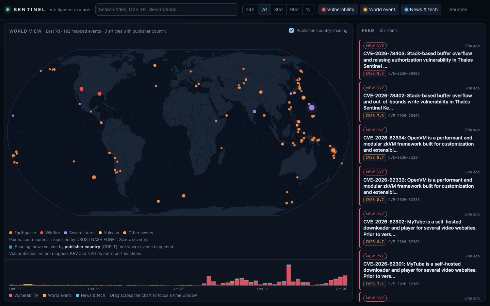

# SENTINEL

**An interactive intelligence explorer.** SENTINEL combines exploited vulnerabilities,
technology and AI news, and significant world events into one explorable picture: a world
map, a unified feed, a brushable timeline, and an investigation view showing how items
connect.

**Live:** https://hvstudios.github.io/sentinel/ (a static snapshot rebuilt every 6 hours by GitHub Actions)



- **Real, attributed data.** CISA KEV, NIST NVD, GitHub Security Advisories, FIRST EPSS, USGS, NASA EONET, GDACS, Wikidata, curated news and advisory feeds, GDELT and Hacker News.
  Every item links to its source and shows when it happened, when it was published and when it
  was ingested.
- **Honest geography.** Points appear only where a source reports coordinates.
  News is shaded by *publisher* country and labelled as such. Vulnerabilities are never placed
  on the map, because KEV and NVD do not report a location. The affected *vendors* can be shown
  at their Wikidata headquarters, labelled as such, and only when the name match is
  unambiguous.
- **Facts vs. inferences.** Relationships stated by a source are drawn as solid lines and
  labelled *reported*. Links SENTINEL derives from text (e.g. a headline mentioning a CVE ID or
  vendor) are dashed, labelled *inferred*, and carry a confidence and a rationale.
- **A balanced feed.** By default the feed takes from vulnerabilities, world events and news in
  turn, so a burst of new CVEs doesn't hide everything else. "Top" orders each category by
  severity, with known-exploited CVEs first. Articles get a SENTINEL rank whose factors are
  shown in the investigation view.
- **Stories.** Related CVEs, advisories and articles are grouped into stories that evolve over
  time. They are linked only by shared identifiers, exploit chains, the same exploited product,
  or near-identical headlines, with the reason shown for every item. No AI model is involved.
- **Watchlists.** Watch a vendor, product, vulnerability or story (★). New related items are
  counted and highlighted in the feed. The watchlist is stored only in your browser, so it also
  works on the static site.
- **Accessible.** Keyboard navigation throughout (the map and graph are single Tab stops with arrow
  keys), focus management, WCAG 2.2 AA contrast, and a phone layout. An automated axe audit runs
  in the end-to-end suite.
- **No paid services, no LLM, no infrastructure.** One Node process and one SQLite file.

See [docs/PRODUCT.md](docs/PRODUCT.md) for the product spec, [docs/ARCHITECTURE.md](docs/ARCHITECTURE.md)
for the design, and [docs/BACKLOG.md](docs/BACKLOG.md) for the prioritised backlog and status.

## Requirements

- Node.js **24** or newer (uses built-in TypeScript type stripping and `node:sqlite`).
  Node ≥ 24.15 is recommended, since the jsdom test dependency declares it.
- Internet access for ingestion. Tests run fully offline.

## Quick start

```bash
npm install
```

```bash
npm run ingest
```

```bash
npm start
```

Then open http://127.0.0.1:8787.

`npm run ingest` fetches all sources into `data/sentinel.db`. The first run takes about a
minute, mostly NVD's rate limit. `npm start` builds the web app and serves it together with
the API.

To refresh only some sources:

```bash
npm run ingest -- -- --only cisa-kev,first-epss,usgs-earthquakes
```

Source IDs: `cisa-kev`, `nvd`, `github-advisories`, `first-epss`, `wikidata-vendors`, `usgs-earthquakes`, `nasa-eonet`, `gdacs`, `news-feeds`,
`gdelt`, `hacker-news`. You can also refresh from the UI under **Sources → Refresh all sources**.

### Development

```bash
npm run dev
```

This runs the API with `--watch` on port 8787 and Vite on http://localhost:5173 (with `/api`
proxied to the API).

## Hosted version (GitHub Pages)

SENTINEL can run without a server. `.github/workflows/pages.yml` ingests fresh data every
6 hours, exports it to a static `snapshot.json`, and publishes the app to GitHub Pages. In
that build the browser answers every query from the snapshot, and the header shows how old
the snapshot is.

One-time setup:
1. GitHub Pages must be available for the repository. Free accounts only get Pages on
   **public** repositories; private repositories need GitHub Pro, Team or Enterprise.
2. **Settings → Pages → Source: GitHub Actions**.
3. Optional: add a free [NVD API key](https://nvd.nist.gov/developers/request-an-api-key) as
   the repository secret `NVD_API_KEY`.

The workflow runs on pushes to `main`, on its schedule, or manually under
**Actions → Publish snapshot to GitHub Pages → Run workflow**.

To try the static build locally:

```bash
VITE_BASE=/sentinel/ npm run build:static
```

```bash
cd web && VITE_BASE=/sentinel/ npx vite preview
```

## Testing

```bash
npm run check
```

`check` runs strict TypeScript checks for both workspaces (and the e2e specs), then all
unit and integration tests, then the production build. CI (`.github/workflows/ci.yml`) runs the same steps. Individual steps:
`npm run typecheck`, `npm test`, `npm run build`.

- **Server (Vitest):** source parsers against real recorded payloads in `server/test/fixtures/`,
  store semantics (idempotent merges, atomic batches, paging), inference rules, the full
  offline ingest pipeline with failure isolation, HTTP retry/rate-limit helpers, and API
  integration via Fastify `inject()`.
- **Static parity:** the snapshot engine used on GitHub Pages is checked against the SQL queries
  on the same ingested data.
- **End-to-end (Playwright):** `npm run e2e` seeds an offline database from the recorded fixtures,
  builds the live app and the static Pages build, and runs the same browser specs against both
  with a frozen clock. The specs cover loading without console errors, category and search
  filters, feed order, investigating a CVE and following the graph to product and vendor, deep
  links, map points, vendor headquarters, timeline brushing, the Sources panel, keyboard-only use,
  an axe-core WCAG 2.2 A/AA audit (which must report zero violations), and a 375 px phone layout. Run
  `npx playwright install chromium` once first.
- **Web (Vitest + Testing Library + jsdom):** formatting and geography helpers, the map
  (points, publisher-country shading, unmapped countries), feed, timeline brushing,
  investigation panel (reported vs inferred), and app-level filtering and navigation.

## Configuration

| Variable | Default | Purpose |
|---|---|---|
| `PORT` | `8787` | API/web port |
| `HOST` | `127.0.0.1` | Bind address. `POST /api/ingest` is only enabled on loopback. |
| `SENTINEL_DB` | `data/sentinel.db` | SQLite file, relative to the repo root |
| `NVD_API_KEY` | — | Optional free NVD key; raises the limit from 5 to 50 requests per 30 s |
| `GITHUB_TOKEN` | — | Optional; raises the GitHub advisories API limit from 60 to 1,000 requests an hour (set automatically in GitHub Actions) |
| `NVD_RECENT_DAYS` | `3` | Window for recently published CVEs (only CVSS ≥ 7 or KEV-listed CVEs are kept) |

## Data sources

| Source | What SENTINEL uses | Geography |
|---|---|---|
| [CISA KEV](https://www.cisa.gov/known-exploited-vulnerabilities-catalog) | Exploited CVEs, vendor/product, due dates, ransomware use | none |
| [NIST NVD](https://nvd.nist.gov/developers) | CVSS, CWE, affected products (CPE), references | none |
| [FIRST EPSS](https://www.first.org/epss/) | Exploit probability and percentile | none |
| [GitHub Security Advisories](https://github.com/advisories) | Reviewed high/critical advisories for open-source packages (npm, PyPI, Go, crates.io…), affected version ranges and fixes | none |
| [USGS](https://earthquake.usgs.gov/earthquakes/feed/) | Significant (month) and M4.5+ (week) earthquakes | source coordinates |
| [NASA EONET](https://eonet.gsfc.nasa.gov/) | Open natural events (wildfires, storms, volcanoes…) | source point coordinates |
| [GDACS](https://www.gdacs.org/) | Orange/Red disaster alerts of all types, plus Green cyclones and volcanoes; enriches matching USGS/EONET events with the alert level | epicentre, or centroid of the affected area; multi-country events (e.g. droughts) are not drawn as a point |
| [Wikidata](https://www.wikidata.org/) | Vendor headquarters (city, country, coordinates), looked up by vendor name | vendor HQ only; the identity match is shown as inferred |
| [Curated feeds](server/src/sources/feeds.ts) | 17 RSS/Atom feeds: security news, government advisories (CISA, NCSC UK, CERT-FR, Canadian Cyber Centre), tech and AI | publisher country only, configured per outlet with a reference link |
| [GDELT DOC 2.0](https://www.gdeltproject.org/) | Security and tech/AI news (best effort, often rate-limited) | publisher country only |
| [Hacker News](https://hn.algolia.com/api) | Tech stories with ≥ 100 points | none |

This product uses data from the NVD API but is not endorsed or certified by the NVD.

## Project layout

```
server/src/
  sources/     one module per source: fetch + pure parse()
  store.ts     SQLite schema, merges, queries (feed, map, timeline, graph)
  relate.ts    relationship inference and severity ranking
  ingest.ts    orchestration with per-source failure isolation
  api.ts       Fastify routes          main.ts  server entry
  snapshot.ts  static export for GitHub Pages (npm run export)
shared/        related.ts: what a watched item relates to (used by server and static build)
web/src/
  components/  WorldMap, Timeline, Feed, Investigate, Graph, SourcesPanel
  staticApi.ts client-side query engine over snapshot.json (static mode)
  lib/         formatting, country-name mapping, fetch hook
docs/          product spec, architecture, backlog
scripts/       dev runner, GitHub issue creation from the backlog
```

## Known limitations

- **GDELT** often answers with HTTP 429 or empty results, locally and on GitHub's runners.
  Publisher-country shading therefore comes mainly from the curated feeds. To add a feed, add an
  entry to `server/src/sources/feeds.ts` with the outlet's country and a page that confirms it.
- Stories are deliberately conservative. Coverage that uses different words and no shared
  identifier (e.g. two very differently phrased headlines) stays separate.
- Wikidata matching is conservative: about a quarter of vendors get a mappable match.
- Duplicate vendor spellings (KEV's "Palo Alto Networks" vs NVD's "paloaltonetworks") are merged
  by two conservative name rules, and the other spellings are listed as "Also known as". Pairs the
  rules don't cover (e.g. "Aquasec" vs "Aqua Security") stay separate.
- Feed-level problems (e.g. one outlet timing out) keep the source "ok" and are listed as warnings
  in the Sources panel.
- Vendor-name matching is deliberately conservative (case-sensitive, with a stop-list) and is
  always shown as *inferred* (60%). False positives are still possible, e.g. "Apple" or "Meta".
- The 1:110m base map omits very small countries. Those are listed under the map rather than
  drawn somewhere approximate.

## Backlog and GitHub Issues

The backlog lives in [docs/BACKLOG.md](docs/BACKLOG.md). To mirror it into GitHub Issues
(already-done items are created closed):

```bash
node scripts/create-github-issues.mjs --dry-run
```

```bash
node scripts/create-github-issues.mjs --repo HVStudios/sentinel
```
